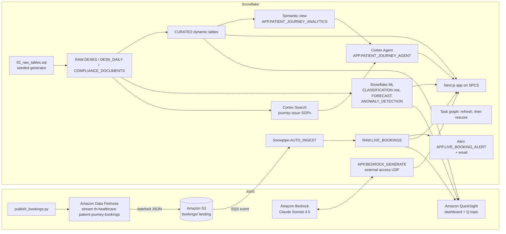

# Thailand International Patient Journey - Appointment Integrity and Cancellation Risk

Patient journey operations for **40 fictional international patient coordination desks of a fictional Thai private hospital group**, covering five service lines in five real cities used as regions (Bangkok, Phuket, Chiang Mai, Pattaya, Hua Hin). Snowflake, optionally with AWS, takes the international patient services team from a live journey issue (a declined payment guarantee, a missing interpreter, a delayed visa support letter) to a 7-day appointment-cancellation risk score per desk, an alert email and an AI action memo. All data is aggregate desk-day counts: there are no patient-level records, no clinical data and no outcomes of care.

## Architecture

The pipeline runs on **Snowflake** (Dynamic Tables, Snowflake ML, Cortex Search, Cortex Agent, Cortex AI_COMPLETE, SPCS) and, in the full build, also uses **AWS** (Amazon Data Firehose, S3, Bedrock Claude, QuickSight + Amazon Q). Appointment booking events arrive in `RAW.LIVE_BOOKINGS`. Dynamic tables roll 90 days of desk-day rows into appointments booked, quoted package value in THB, journey issues, cancelled appointments, late arrivals, issue-free appointment rate and pre-arrival checklist audit compliance. Snowflake ML predicts which desks are likely to have a cancelled appointment in the next 7 days, forecasts journey issues across the group and flags unusual payment guarantee decline rates. A Cortex Agent answers with SQL and SOP citations, and an LLM drafts the international patient services team's action memo.

Interactive diagrams (hover for object names): [Snowflake only](docs/architecture-snowflake.html) | [AWS + Snowflake](docs/architecture-aws.html). The app's Architecture & Data tab shows both, the current build first. Regenerate them with `python3 docs/build_architecture.py aws snowflake`.



In the Snowflake-only build there is no AWS subgraph: `APP.SIMULATE_BOOKINGS` writes to `RAW.LIVE_BOOKINGS`, and the app calls Cortex `AI_COMPLETE` in place of the Bedrock UDF.

## Snowflake Capabilities

| Capability | Implementation |
|-----------|---------------|
| Dynamic Tables | `CURATED.KPI_SUMMARY`, `PERFORMANCE_SUMMARY`, `ISSUE_SUMMARY`, `TREND_ANALYSIS`, built from the RAW tables |
| Snowflake ML | CLASSIFICATION of 7-day appointment-cancellation risk (`ML.CANCEL_RISK_SCORES`), a 14-day journey-issue FORECAST, and payment guarantee decline rate ANOMALY_DETECTION |
| Cortex Search | 14 synthetic, administrative journey-issue SOPs (one per service line and issue type) in `SEARCH.ISSUE_SOP_SEARCH` |
| Semantic View | `APP.PATIENT_JOURNEY_ANALYTICS` over desks, issue types, daily totals and risk |
| Cortex Agent | `APP.PATIENT_JOURNEY_AGENT`: Cortex Analyst over the semantic view, plus Cortex Search for SOP citations |
| Cortex AI | `AI_COMPLETE('claude-sonnet-4-5')` for grounded answers, and for the action memo in the Snowflake-only build |
| Alerts + Tasks | `APP.LIVE_BOOKING_ALERT` logs ISSUE events and sends email; task graph `TASK_REFRESH_CURATED`, then `TASK_RESCORE_RISK` |
| Snowpark Container Services | Next.js app `APP.TH_HEALTHCARE_PATIENT_JOURNEY_APP` with 6 tabs: Executive Cockpit, Predictive, Controls, Live Bookings, Ask AI, Architecture & Data |
| Snowpipe | `RAW.LIVE_BOOKINGS_PIPE` AUTO_INGEST from S3 (AWS build only) |

## AWS Services

These run only in the AWS + Snowflake build.

| Service | Role in Demo |
|---------|-------------|
| Amazon Data Firehose | Direct PUT stream `th-healthcare-patient-journey-bookings` takes simulated appointment booking events (desk-level, no patient data) and writes them to S3 in batches |
| Amazon S3 | Landing bucket (`bookings/`); an event notification goes to the Snowpipe SQS queue |
| Amazon Bedrock | Claude Sonnet 4.5 drafts the action memo, called from Snowflake through an external-access UDF |
| Amazon QuickSight | DIRECT_QUERY patient journey dashboard over Snowflake (daily journey issues, cancelled appointments by desk, appointment-cancellation risk) |
| Amazon Q | Natural-language questions over the QuickSight topic `th-healthcare-patient-journey-topic` |
| AWS IAM | Least-privilege roles for S3, Firehose and Bedrock |

## Personas

Both personas are fictional.

| Persona | Role | Key Questions |
|---------|------|---------------|
| **Kanokwan Thongdee** | Head of International Patient Services | "How many appointments go through without a journey issue?" "Which issue types end in a cancelled appointment most often?" |
| **Thanakorn Wongsa** | Patient Journey Analyst | "Which desks need a review this week, and what does the SOP say to do?" |

## Data

Every table is synthetic and HASH-seeded, so a rebuild reproduces it. The hospital group, its desks and all names are fictional; the five cities are real Thai cities used only as regions. Rows are aggregate counts per desk per day; no table holds patient-level, clinical or diagnostic data.

| Table | Rows | Description |
|-------|------|-------------|
| RAW.DESKS | 40 | Coordination desks in 5 Thai cities and 5 service lines (Health check-up, Dental, Orthopaedics, Cardiology, Fertility), with an operating risk tier |
| RAW.DESK_DAILY | 3,600 | One row per desk per day for 90 days: appointments booked, quoted package value (THB), journey issues, cancelled appointments, late arrivals, issue type, pre-arrival checklist audits, payment guarantee decline rate and inquiry response time |
| RAW.COMPLIANCE_DOCUMENTS | 40 | Required, on-file and pending desk documents per desk (price sheets, insurer agreements, interpreter rosters and similar) |
| SEARCH.ISSUE_DOCS | 14 | Synthetic, administrative journey-issue SOPs indexed for Cortex Search |
| RAW.LIVE_BOOKINGS | Grows during the demo | Live appointment booking events from Firehose (AWS build) or `APP.SIMULATE_BOOKINGS` (Snowflake-only build) |
| ML.CANCEL_RISK_SCORES | 40 | 7-day appointment-cancellation probability and risk band per desk |

## Build Instructions

### Prerequisites
- Snowflake account with ACCOUNTADMIN access, and Cortex AI enabled (AI_COMPLETE, Search, Agent).
- An X-Small warehouse with auto-suspend at or below 120 s, and an existing SPCS compute pool.
- Python 3.11+, `snowflake-connector-python`, Node.js 22+, Docker and the `snow` CLI.
- App image: run `snow spcs image-registry login`, then build and push `th-healthcare-patient-journey-app:v1` to the database's `APP.IMAGES` repository (see the header of `snowflake/07_deploy_app.sql`).
- AWS build only: `boto3`, AWS credentials for the target account (us-west-2) with Bedrock access, and QuickSight Enterprise.

### SPCS App
```
<DATABASE>.APP.TH_HEALTHCARE_PATIENT_JOURNEY_APP
```

### Tests
```bash
python -m pytest aws snowflake quicksight
```

For a local run, put `SNOWFLAKE_ACCOUNT`, `SNOWFLAKE_USER`, `SNOWFLAKE_DATABASE`, `SNOWFLAKE_WAREHOUSE`, `SNOWFLAKE_AUTHENTICATOR=PROGRAMMATIC_ACCESS_TOKEN`, `SNOWFLAKE_TOKEN` and `DEMO_PLATFORM` in the environment, then run `npm --prefix app run build && npm --prefix app start`.

## Build Modes

The two modes run on one shared core and differ in three layers. The `DEMO_PLATFORM` value in the app SPCS spec selects the memo provider and the Live Bookings copy.

| Layer | Snowflake Only | Full AWS + Snowflake |
|---|---|---|
| Live bookings | `CALL APP.SIMULATE_BOOKINGS(n)` inserts simulated appointment booking events into `RAW.LIVE_BOOKINGS`. This simulates a booking feed; it is not Snowpipe Streaming | `aws/publish_bookings.py` to Amazon Data Firehose, then S3, SQS and Snowpipe AUTO_INGEST |
| Action memo | Cortex `AI_COMPLETE('claude-sonnet-4-5')` | Amazon Bedrock Claude Sonnet 4.5 through `APP.BEDROCK_GENERATE` |
| BI and natural-language questions | The SPCS app is the dashboard; questions go to the Cortex Agent | Also a QuickSight dashboard and an Amazon Q topic |
| App setting | `DEMO_PLATFORM: snowflake` | `DEMO_PLATFORM: aws` |

### Snowflake Only

```bash
# 1. Core data and dynamic tables (guarded: new isolated database only)
python snowflake/run_core.py --database THAILAND_HEALTHCARE_PATIENT_JOURNEY_SNOWFLAKE --warehouse <XS_WAREHOUSE> --connection <CONNECTION> --apply
# 2. Native booking feed, ML, search, semantic view, agent, alert and task graph
python snowflake/run_intelligence.py --database THAILAND_HEALTHCARE_PATIENT_JOURNEY_SNOWFLAKE --platform snowflake --warehouse <XS_WAREHOUSE> --connection <CONNECTION> --alert-email you@example.com
# 3. App on SPCS with DEMO_PLATFORM=snowflake (push the image first)
python snowflake/run_intelligence.py --database THAILAND_HEALTHCARE_PATIENT_JOURNEY_SNOWFLAKE --platform snowflake --warehouse <XS_WAREHOUSE> --connection <CONNECTION> --alert-email you@example.com --files 07_deploy_app.sql --compute-pool <COMPUTE_POOL>
```

During the demo:
- Run `CALL APP.SIMULATE_BOOKINGS(20)` to add live booking events. For a continuous feed, run `ALTER TASK APP.TASK_SIMULATE_BOOKINGS RESUME`, and `SUSPEND` it afterwards.
- Run `EXECUTE ALERT APP.LIVE_BOOKING_ALERT` to raise the alert email.
- Run `EXECUTE TASK APP.TASK_REFRESH_CURATED` to refresh the curated tables and rescore risk.

Afterwards, drop the database or run `ALTER SERVICE APP.TH_HEALTHCARE_PATIENT_JOURNEY_APP SUSPEND`.

### Full AWS + Snowflake

```bash
# 1. Core data and dynamic tables (guarded: new isolated database only)
python snowflake/run_core.py --database THAILAND_HEALTHCARE_PATIENT_JOURNEY_AWS --warehouse <XS_WAREHOUSE> --connection <CONNECTION> --apply
# 2. AWS ingestion and Bedrock (dry run first, then --apply)
python aws/setup_aws.py --database THAILAND_HEALTHCARE_PATIENT_JOURNEY_AWS --account <AWS_ACCOUNT_ID> --connection <CONNECTION> --apply
# 3. ML, search, semantic view, agent, alert and task graph
python snowflake/run_intelligence.py --database THAILAND_HEALTHCARE_PATIENT_JOURNEY_AWS --platform aws --warehouse <XS_WAREHOUSE> --connection <CONNECTION> --alert-email you@example.com
# 4. App on SPCS with DEMO_PLATFORM=aws (push the image first)
python snowflake/run_intelligence.py --database THAILAND_HEALTHCARE_PATIENT_JOURNEY_AWS --platform aws --warehouse <XS_WAREHOUSE> --connection <CONNECTION> --alert-email you@example.com --files 07_deploy_app.sql --compute-pool <COMPUTE_POOL>
# 5. QuickSight dashboard and Q topic (needs an existing Snowflake data source)
python quicksight/build_dashboards.py --database THAILAND_HEALTHCARE_PATIENT_JOURNEY_AWS --account <AWS_ACCOUNT_ID> --principal-arn <QUICKSIGHT_USER_ARN> --data-source-arn <DATA_SOURCE_ARN> --prefix th-healthcare-patient-journey --apply --update --with-topic
```

QuickSight objects must be shared with the QuickSight user who signs in (`--principal-arn`); otherwise the console shows nothing.

During the demo:
- Run `python aws/publish_bookings.py --count 20` to send live booking events. Firehose buffers for up to 60 seconds before writing to S3.
- Run `EXECUTE ALERT APP.LIVE_BOOKING_ALERT` to raise the alert email.
- Run `EXECUTE TASK APP.TASK_REFRESH_CURATED` to refresh the curated tables and rescore risk.


When you are done, `python aws/teardown_aws.py --database THAILAND_HEALTHCARE_PATIENT_JOURNEY_AWS --account <AWS_ACCOUNT_ID> --connection <CONNECTION> --apply` deletes the AWS resources plus the account-level Bedrock external-access and S3 storage integrations. The email integration `TH_HEALTHCARE_PATIENT_JOURNEY_EMAIL_INT` stays, because the Snowflake-only build uses it too.

## Business Impact

Industry context and a Snowflake customer outcome:
- **Medical tourism is a growth market for the region**: "Thailand, Southeast Asia's largest player in medical tourism, should benefit from industry growth globally, with the region's market expected to expand 43% to US$16 billion by 2030, according to Bumrungrad International Hospital." -- [Bangkok Post, Thailand to gain from medical tourism uptick (31 August 2024)](https://www.bangkokpost.com/business/general/2856972/thailand-to-gain-from-medical-tourism-uptick)
- **Bupa** (Snowflake customer): "In the past, Bupa had to ingest data from its telephone systems overnight in an 11-hour batch process that often competed for resources with other vital workloads. Now, it takes just 60 minutes to ingest these large files — a 90% reduction in processing time that helps contact center teams get better visibility and solve customer issues faster." -- [Snowflake customer story: Bupa](https://www.snowflake.com/en/customers/all-customers/case-study/bupa/)

## Key Demo Numbers

All figures are synthetic and come from the seeded demo data. Forecast and anomaly figures can shift slightly with the build day.

- **40 coordination desks** in 5 Thai cities and 5 service lines, 3,600 desk-days over 90 days: **16,968 appointments booked** with a quoted package value of THB 2.09 B
- **Issue-free appointment rate 96.69%**: **562 journey issues**, of which **176** ended as cancelled appointments (issue cancellation rate 31.3%), and **70 late arrivals**
- **Payment guarantee declined** causes the most cancelled appointments (60 of 165 issues); the 16 flight schedule disruption issues (Phuket and Chiang Mai) were all resolved without a cancellation
- Desks in **Pattaya** have the most cancelled appointments (51); Chiang Mai has the fewest (18)
- **Appointment-cancellation model**, out-of-time holdout: precision 0.32 and recall 0.30 at a 0.5 threshold, against a 0.21 base rate. 7 desks are high risk; the top one, DSK-0003, scores 96.2%
- **14-day journey-issue forecast** with prediction intervals; **32 of 640** recent desk-days flagged as payment guarantee decline rate anomalies
- **Pre-arrival checklist audit compliance 76.6%**; desk document coverage 50.0%, with 22 documents pending
- **14 SOPs** indexed in Cortex Search and cited by ID in agent answers

## License

Apache 2.0 — See [LICENSE](LICENSE) for details.

This is a personal demo project and is not an official Snowflake offering. It comes with no support or warranty. Industry metrics cited are from publicly available third-party sources and Snowflake customer stories; they represent reported outcomes and are not guarantees of results. The demo shows administrative patient journey operations only and makes no clinical, diagnostic or treatment claims.
